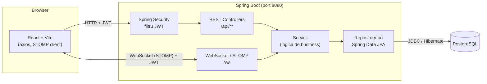
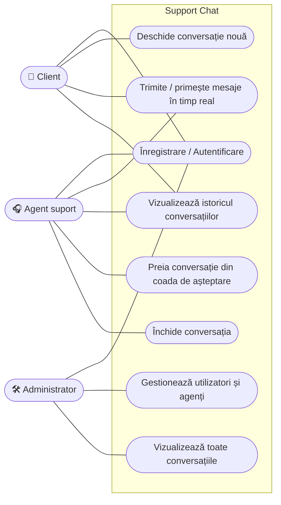
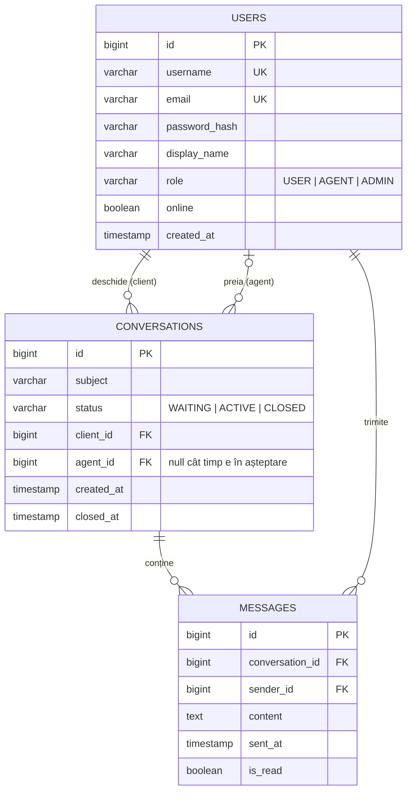
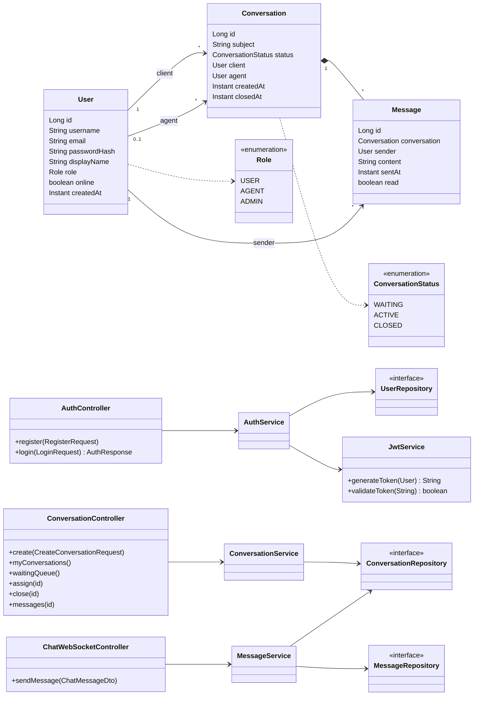
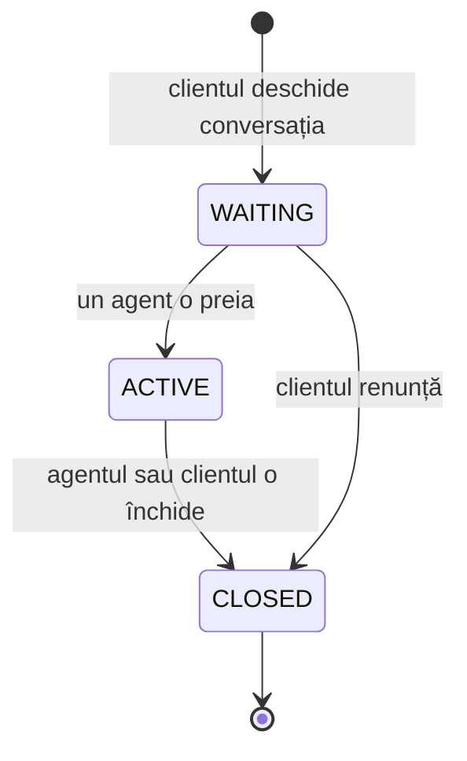
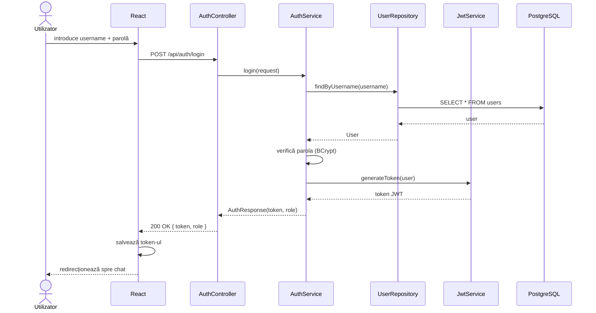
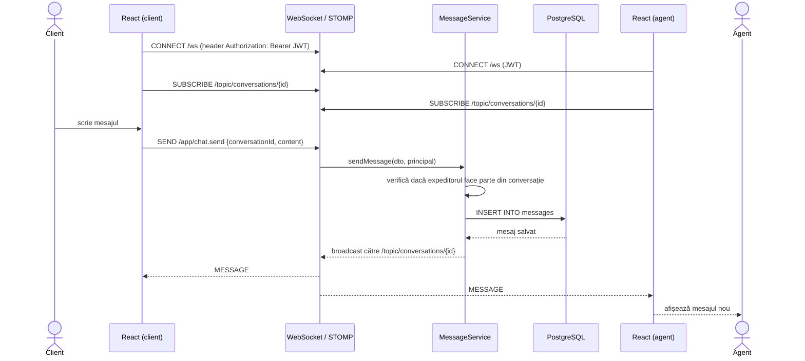
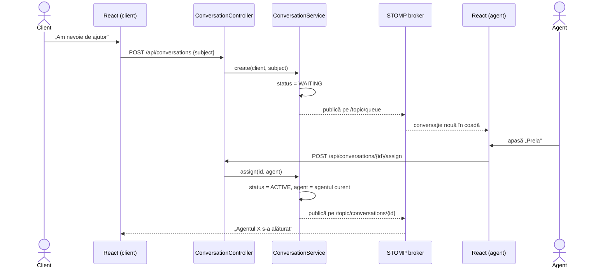

# Support Chat — Diagrame

Diagramele sunt scrise în [Mermaid](https://mermaid.js.org/) și se randează direct pe GitHub
sau în VS Code (extensia *Markdown Preview Mermaid Support*).

## 1. Arhitectura sistemului

## 2. Cazuri de utilizare

## 3. Diagrama bazei de date (ER)

## 4. Diagrama de clase (backend)

## 5. Ciclul de viață al unei conversații

## 6. Secvență — autentificare (JWT)

## 7. Secvență — trimiterea unui mesaj în timp real

## 8. Secvență — preluarea unei conversații de către agent

